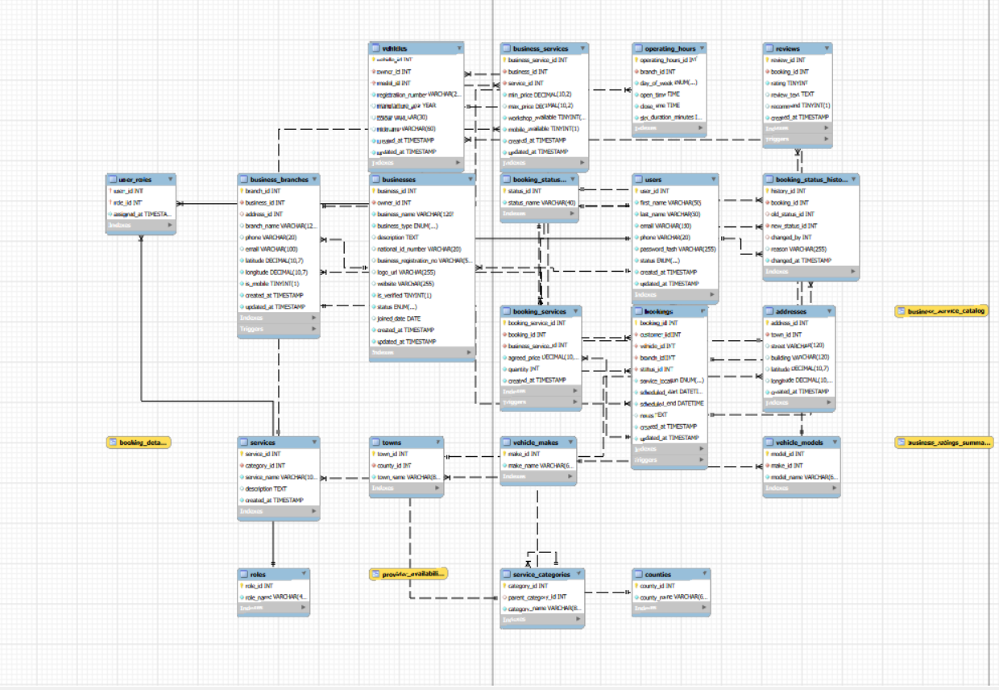

# CarRadar — Database-First Car Services Marketplace

CarRadar is a personal database design project for a car-services marketplace in Kenya, initially focused on detailing. Its purpose is to demonstrate relational modelling, normalization decisions, referential integrity, SQL constraints, indexing and database triggers using MySQL and MySQL Workbench.

The database models customers, providers, service discovery, vehicles, bookings and reviews. It supports mobile services and fixed workshops. Payments are outside the current scope. This repository focuses entirely on the database and its documentation.

## Database at a glance

The supplied SQL defines **19 tables and four triggers**. It is the reference for implementation claims in this README. It has been inspected statically; it has not been executed or benchmarked as part of this review.

| Area | Tables | Design purpose |
| --- | --- | --- |
| Identity and access | `users`, `roles`, `user_roles` | One identity can hold multiple roles, including customer and provider roles |
| Locations | `counties`, `towns`, `addresses` | Reusable geographic hierarchy |
| Providers | `businesses`, `business_branches`, `operating_hours` | Ownership, individual/company providers, branch locations, and daily opening hours |
| Service catalogue | `service_categories`, `services`, `business_services` | Category hierarchy, reusable services, provider pricing, and mobile/workshop availability |
| Vehicles | `vehicle_makes`, `vehicle_models`, `vehicles` | Separate manufacturer and model reference data from customer vehicles |
| Bookings and feedback | `booking_statuses`, `bookings`, `booking_services`, `reviews` | Scheduled work, multiple service lines, agreed prices, and one review per booking |

## Schema diagram



The screenshot is the supplied Workbench model, retained as design evidence. It also shows booking status history and view objects whose definitions are absent from the supplied SQL; it is not an exact representation of `database/schema.sql`. Some labels are small: open the image separately to inspect it. A synchronized, higher-resolution export is a future documentation task.

## Database design work demonstrated

- **Multiple roles per identity:** `user_roles` uses a composite primary key to prevent duplicate role assignments without duplicating user accounts.
- **Reusable reference data:** makes/models and counties/towns are separated rather than repeated as free-text descriptions on every vehicle or address.
- **Many-to-many modelling:** `business_services` records each provider/service pair, pricing, and delivery options. A unique constraint prevents duplicate pairs.
- **Booking line items:** `booking_services` supports multiple services per booking and stores the agreed price separately from the provider's current advertised price.
- **Referential integrity:** named foreign keys connect the model, with `CASCADE`, `RESTRICT`, and `SET NULL` chosen for different relationships. Retention implications still need review.
- **Domain constraints:** time ordering, minimum/maximum price ordering, ratings from 1–5, unique vehicle registration, and one review per booking are expressed in SQL.
- **Triggers:** insert/update checks reject fixed branches without an address and detect overlapping bookings for a branch. The overlap logic uses half-open intervals, allowing adjacent bookings.
- **Query-oriented indexing:** `(branch_id, scheduled_start)` supports branch schedule searches. No performance improvement is claimed without execution-plan and timing evidence.

These features demonstrate efforts to reduce duplication and enforce rules in the database. A formal claim of third normal form would require a complete list of functional dependencies and business assumptions; it has not been established here.

## Files

```text
CarRadar/
├── README.md
├── database/
│   ├── schema.sql                 # Supplied schema, preserved unchanged
│   └── inspection-queries.sql     # Read-only metadata and example queries
└── docs/
    ├── schema-diagram.png         # Supplied Workbench screenshot
    └── schema-review.md           # Design rationale, gaps, and next improvements
```

## Inspect the database locally

Use **MySQL 8.0.16 or later**, with InnoDB as the default storage engine, so the schema's CHECK constraints are enforced. MariaDB compatibility has not been validated.

1. Open MySQL Workbench and connect to a local development server.
2. Check the server with `SELECT VERSION(), @@default_storage_engine;`.
3. Use a fresh development instance where a database named `carradar` does not already contain tables. The script creates that database if absent; its table and trigger statements are not rerunnable migrations.
4. Open `database/schema.sql` and execute it. This creates empty structures, not sample records.
5. Run `database/inspection-queries.sql` to inspect objects and try example queries. Business queries return no rows until you add data.
6. For a diagram matching the SQL, select **Database → Reverse Engineer** and choose `carradar`.

No credentials or actual customer records are included. The schema includes sensitive-data fields such as national ID numbers; demonstrations should use fictional values.

## Review findings and next improvements

The full [schema review](docs/schema-review.md) separates existing work from proposals. Priority gaps include address deletion bypassing the branch rule, concurrent booking races, incoming cancelled/rejected bookings being checked unnecessarily, cross-business booking lines, and missing nonnegative price checks. These are documented findings, not completed fixes.

Transactions, concurrency tests, sample data, status history, view definitions, and index benchmarks remain future evidence. The current overlap rule assumes a branch can handle only one active booking at a time; workshops with multiple bays need a capacity/resource model.

## Author

[Nduta06](https://github.com/Nduta06) — personal database portfolio project.
